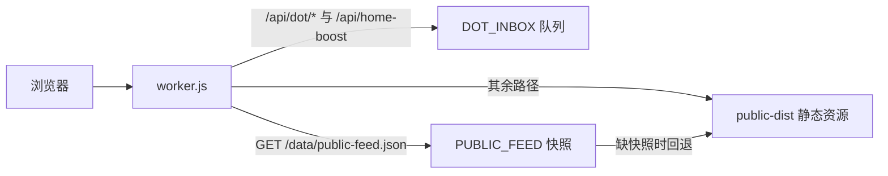

# 架构

公开站名叫 **Levi flow**。预览 Worker 是 `woyun-feed-preview`，地址 <https://woyun-feed-preview.hhzovo66.workers.dev/>。熟人软启动就在这个地址上。正式域名未定。生产 Worker `woyun` 不由这份配置发布。

页面是原生 HTML、CSS、JavaScript。Cloudflare Worker 负责少数动态路径和两路定时，静态文件放在同一次部署的 `public-dist` 里。

## 一次请求

`wrangler.jsonc` 里 `run_worker_first` 把这几条交给 Worker：`/data/public-feed.json`、`/api/dot/*`、`/api/home-boost`。快照键是 `public-feed:current:v1`。KV 读失败时，`/data/public-feed.json` 回退到已发布的静态文件。

| 路径 | 模块 | 作用 |
| --- | --- | --- |
| `/api/dot/inbox` | `dot-inbox-service.js` | Dot / feedgrab 批次收件，保留 30 天 |
| `/api/dot/pending` | `dot-pending-service.js` | 单条 X 链接进队；接收码读取队列 |
| `/api/dot/pending/decision` | 同上 | 接收码标 `approved` 或 `rejected` |
| `/api/dot/underrated` | `dot-underrated-service.js` | 接收码钉选或撤下「昨日最被低估」 |
| `/api/home-boost` | `frontend/home-boost-service.js` | 首页已助力计数 |
| `/review-admin` | 只在本机 `frontend/serve.js` | 过审页。公开预览没有这条 |

私有 KV `DOT_INBOX` 里和协作有关的键：

| 键 | 内容 |
| --- | --- |
| `pending:` 前缀 | 待筛选、已过审、已略过，上限 300 条 |
| `kosx_pool_handles` | 小写的 KOSX 账号池 handle，缓存超过 1 小时会再拉 |
| `underrated:pins:v1` | 低估钉选，库最多 8 条，首页最多显示 2 条 |
| `essence_sweep:v1` | 精华扫榜的成败与退避 |

账号池来自公开接口 <https://impact.kosx.ai/api/members> 的 `members[].handle`。粉丝数不写入 KV，也不参与排序。首页上的 KOSX 标记读的是随静态资源发布的 `kosx-pool.js`，名单变化要等下一次构建部署才换标记；进料自动过审读的是 KV 缓存，不必为了名单再部署。

## 一条帖怎么到公开栏

1. 首页「贴链接」只提交一条 X URL，来源记为 `homepage`，进队停在 `pending`。超过 1 小时（`HOMEPAGE_AUTO_APPROVE_MS`，`1 * 60 * 60 * 1000` 毫秒）仍是 `pending` 的，定时任务标成 `approved`（`approval: auto`）。时间用 `submitted_at`，没有则用 `created_at`。刚好 1 小时继续等人。不钉低估栏。
2. Overheard 用投递密钥 `POST /api/dot/pending`。作者在账号池里、并且按当前规则不会落在「昨日全部」时，进队当场标成 `approved`（`approval: pool`）并写入公开快照。会落在「昨日全部」的，保持 `pending`。
3. 精华扫榜从**已经写在 KV 里的快照**里挑池内帖子进队。它不新开 X 时间线。时间表见 [ops-cron.md](ops-cron.md)。
4. 投递来源满 3 小时（`PENDING_AUTO_APPROVE_MS`，`3 * 60 * 60 * 1000` 毫秒）仍是 `pending` 的，定时任务标成 `approved`（`approval: auto`）。贴链接不走这 3 小时。自动过审不钉低估栏。账号池进队当场过审不变。
5. 本机 `/review-admin` 用接收码把 `pending` 标成 `approved` 或 `rejected`。只有 `approved` 出现在公开首页。
6. 「昨日最被低估」只显示人工钉选、并且这条钉选对得上「昨日全部」的帖。没有钉选时这一栏留空。

公开刷新重建首页快照，并把队列里的 `approved` 接回去。只停在 `pending` 的链接不会被接回去。扫榜和公开刷新的分工见 [ops-cron.md](ops-cron.md)。

## 五条公开栏

选择在 `frontend/src/homeShowcase.js` 的 `selectHomeShowcase`。整理日优先用快照 `generated_at`。

- **最新精华。** 精华线里，原帖北京日落在整理日往前 3 个自然日（含整理日）的帖，最多 18 条（`HOME_LATEST_LIMIT`）。栏内排序看放上首页的时间。
- **昨日全部。** 精华线里，原帖北京日是整理日前一天的帖。账号池自动放上首页的帖也在这里。
- **昨日最被低估。** 人工钉选，并且落在「昨日全部」里，按钉选顺序，最多 2 条。可以是空的。抽奖等已被质量规则收起的帖不会因为钉选重新出现。
- **七日精选。** 整理日往前共 7 个北京时间自然日（含整理日）里的精华文章。文章指类型是「文章」或「教程指南」、带有 Article 卡，或摘录里已有操作线索。短帖、产品安利、避坑不进。收藏数只读公开条目上的 `bookmark_count`，达到 200（`HOME_WEEK_BOOKMARK_MIN`）才留下。这批文章里只要有可读的收藏数，就不改用曝光或浏览量。整批都没有收藏数时，`pickWeek` 还有热度中位数、再退回按时间留下文章这两步。
- **卧云精选。** 同一条精华线上的文章，不限日期，`bookmark_count` 达到 1000（`HOME_KEPT_BOOKMARK_MIN`）。没有收藏数的不进。这里没有热度退路。

扫榜进队看的是近 2 个北京日（今天和昨天），每轮最多 20 条。那是队列窗口，和首页「最新精华」的 3 日、18 条不是同一个数。

### 空白封面与占位标题

空白封面由 `frontend/src/coverFace.js` 的 `blankPublicCover` 判定，并且已经拦在公开栏外面。没有可用摘录，并且 `showcaseCoverMedia` 也没有封面图或同一条帖的图片，这张脸就是空白。流程说明、补仓备注和「待人工过审」不当成摘录。同一条帖的另一份副本如果带着摘录，这张脸可以留下。

`selectHomeShowcase` 里的 `showCover` 就是 `!blankPublicCover(entry.post)`。最新精华、昨日全部、七日精选、卧云精选都走这道过滤。昨日最被低估只从已经通过过滤的「昨日全部」里钉，所以空白封面也不进这一栏。测试是 `frontend/test-home-showcase.js` 里的 “blank public covers stay off every homepage rail”。

占位标题 `@handle 的精华帖` 可以当卡片标题，只要摘录还在。样式里仍留着紧凑的 `data-cover="plain"`，给个别边角用；公开栏的选择已经把空白封面排除在外。

## 内容政策

公开栏不收这些：

- 抽奖、转发或关注换奖、参与领奖
- 硬广，以及只有外链、没有正文的引流
- NSFW、露骨内容
- 欺诈、违法

软启动保留这些自动规则。投递来源超过 3 小时仍未人工处理，可以自动过审上首页，不自动钉低估。首页贴链接超过 1 小时仍未人工处理，同样可以自动过审上首页，不自动钉低估。刚好到达对应时长的继续等人。账号池成员的投递仍在进队当时放上首页。密钥、私钥和本机路径仍不能放上公开首页。抽奖、硬广等折叠规则不变。

`frontend/src/postQuality.js` 会折叠抽奖、入金换奖励、邀请返佣、进群领取、课程或代理销售、收益承诺，以及标明的推广。折叠是可展开的规则提示。NSFW 和欺诈、违法不靠这条正则挡下，靠过审和上面的编辑规则。

## 目录各自干什么

| 路径 | 改这里的时候 |
| --- | --- |
| `frontend/` | 页面、栏规则、公开采集、本机服务、测试。源码以这里为准 |
| `frontend/src/` | 浏览器里的界面 |
| `frontend/cloud-feed-service.js` | 公开刷新如何写 KV |
| `frontend/essence-sweep.js` | 精华扫榜如何进队 |
| `public-dist/` | 构建结果。执行 `node frontend/public-build.mjs` 重写它，再部署。不要手改后当作源码 |
| `data/` | `demo-feed.json` 供本机演示。`observation-catalog.json` 与 `repository-guides.json` 是本机整理缓存，不随公开首页下发 |
| `scripts/` | `feedgrab-x-collect.py` 读给定的公开 X 链接；`feedgrab-inbox-deliver.mjs` 把信封投到预览 `/api/dot/inbox` |
| `docs/history/` | 版本沿革和带日期的试跑，不是当前操作说明 |
| `docs/archive/` | 旧的布局验收和助手交接 |

`frontend/package.json` 的包名仍是 `personal-feed-frontend`，本机健康检查的 `app` 仍是 `personal-feed`。这是内部标识。对外名称是 Levi flow。

少数源码字符串还写着旧的 workers.dev 子域 `woyun-feed-preview.woyun520.workers.dev`（公开采集的 User-Agent，以及创作者目录里的几个主页链接）。现行预览地址是 `hhzovo66` 这一条。`frontend/local-review.js` 的默认过审上游已经是现行地址。

## 本机还有一块工作台

公开首页是封面栏。本机 `serve.js` 另外保留收藏、主题、待筛选导入和「带走给 AI」。给打开网站的人看的短说明在 [workbench-start-here.md](workbench-start-here.md)。那一页不是部署说明。
